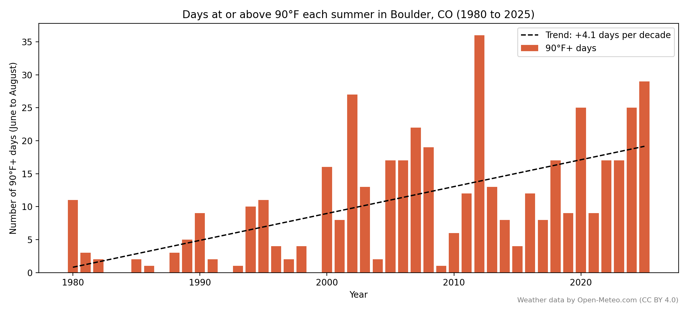
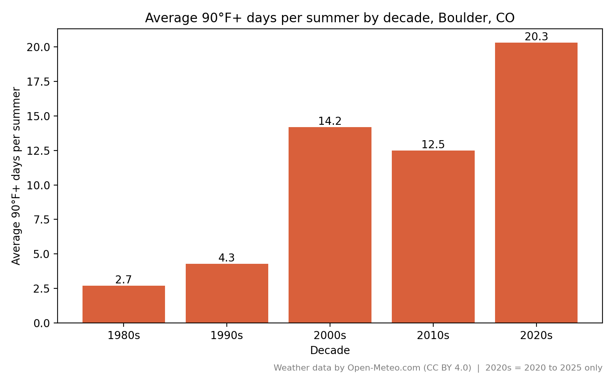

# Boulder's Hot Summers: Counting 90°F Days, 1980–2025

**Author:** Madeleine Deutsch and Dustin Reidy
**Course:** INFO 4617 Web Data Science, CU Boulder, Fall 2026

## Research question

Are Boulder summers getting hotter? This project counts the number of days each summer that reach 90°F or higher in Boulder, Colorado, from 1980 to 2025, and asks whether that number has changed over time. Using historical daily temperature records collected from the web, we look for a trend in extreme heat days across more than four decades and visualize how recent summers compare to earlier ones.

## Data

**Source:** [Open-Meteo Historical Weather API](https://open-meteo.com/en/docs/historical-weather-api), daily maximum temperature (`temperature_2m_max`) for Boulder, Colorado (40.015, -105.2705), in °F. Weather data by Open-Meteo.com (CC BY 4.0).

**Collected:** November 7, 2026, with `analysis.ipynb`. We sent 46 requests (one per summer), with a User-Agent identifying the project and a 1 second pause between requests.

**Records:** 4,232 days (June 1 to August 31 for each of 46 summers, 1980 to 2025, 92 days each). Each row has the date, year, month, daily high in °F, and whether it reached 90°F. See the data dictionary in [data/README.md](data/README.md).

**In the repo:** a 20-row sample of the cleaned data, `data/sample_cleaned.csv`.

**Left out:** the 46 raw JSON responses (`data/raw/`) and the full cleaned CSV. The license allows sharing, but they are fully reproducible by running the notebook, and keeping only a sample keeps the repo small. The data contains no personal information.

## Methods

1. **Collect** (`analysis.ipynb`, sections 1 and 2): 46 requests to the Open-Meteo API, one per summer, saved as raw JSON.
2. **Clean** (section 3): combined the files into one table, checked units, missing values, and duplicate dates, kept June to August only, and flagged each day as a 90°F+ day or not.
3. **Count** (section 5): summed the 90°F+ days for each summer and calculated each summer's average daily high (`data/summer_summary.csv`).
4. **Compare decades** (section 6): averaged the hot-day counts for the 1980s, 1990s, 2000s, 2010s, and 2020s (2020 to 2025 only).
5. **Trend** (section 7): fit a simple linear regression of hot days against year to measure the change per decade, and checked the correlation between hot days and average summer highs.

## Findings

- We can see from the data table that hot days are increasing. Boulder gained about 4.1 more 90°F+ days per decade from 1980 to 2025. The 2020s are the hottest decade we've seen so far. Summers averaged 20.3 days at or above 90°F in 2020 to 2025, compared with 2.7 in the 1980s and 4.3 in the 1990s. The jump started around 2000. The 2000s (14.2 days) and 2010s (12.5 days) were both far above the 80s and 90s.
- Hottest summers: 2012 (36 days), 2025 (29 days), 2002 (27 days), 2020 (25 days), and 2024 (25 days). Three of the top five are from the 2020s.

Boulder's number of 90°F+ summer days has risen by about 4 days per decade since 1980, with 2012 the hottest summer in this data.

Summers in the 2020s have averaged about 20 days at or above 90°F, more than seven times the 1980s average.

## How to reproduce

1. Install Python 3.11 with `pandas`, `requests`, `matplotlib`, and `jupyter`.
2. Clone this repo and run `jupyter notebook` in the folder.
3. Open `analysis.ipynb` and choose **Kernel > Restart Kernel and Run All Cells**. It downloads the data (about 1 minute), cleans it, and recreates every table and figure.
